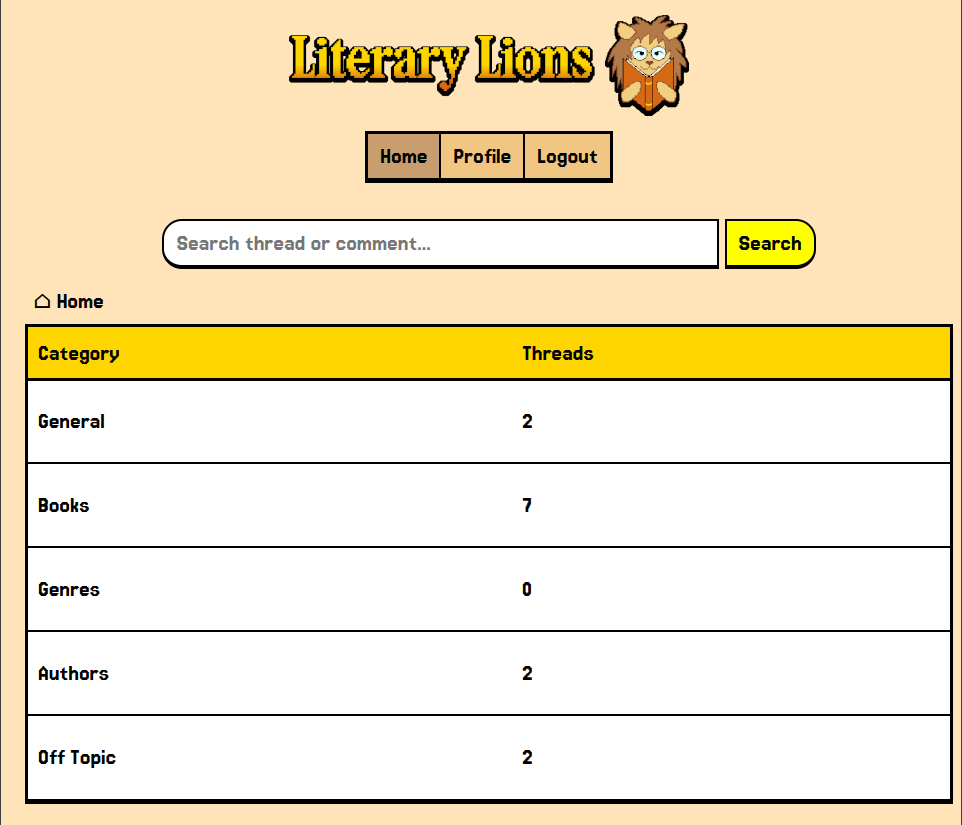
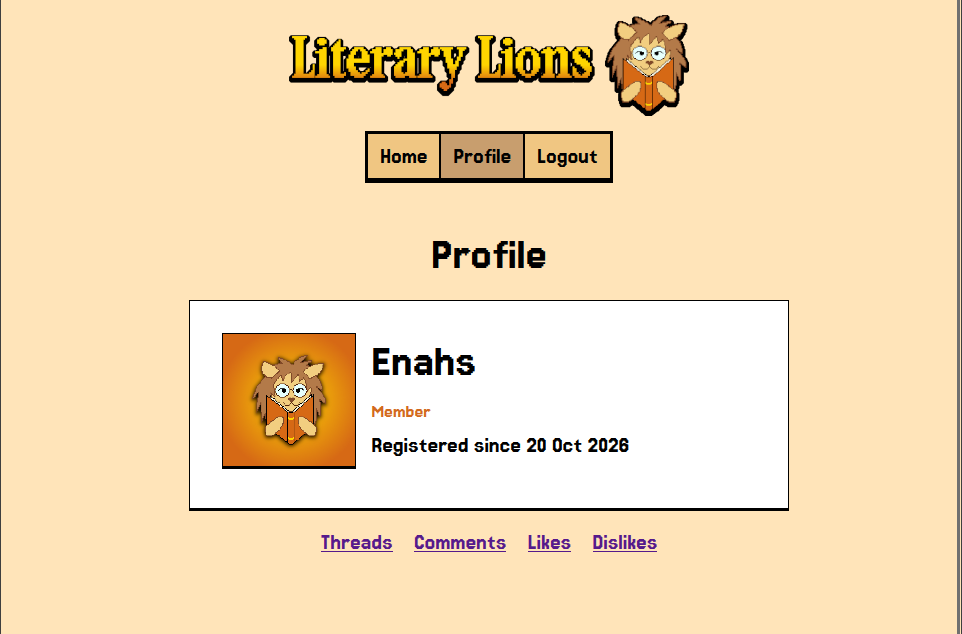
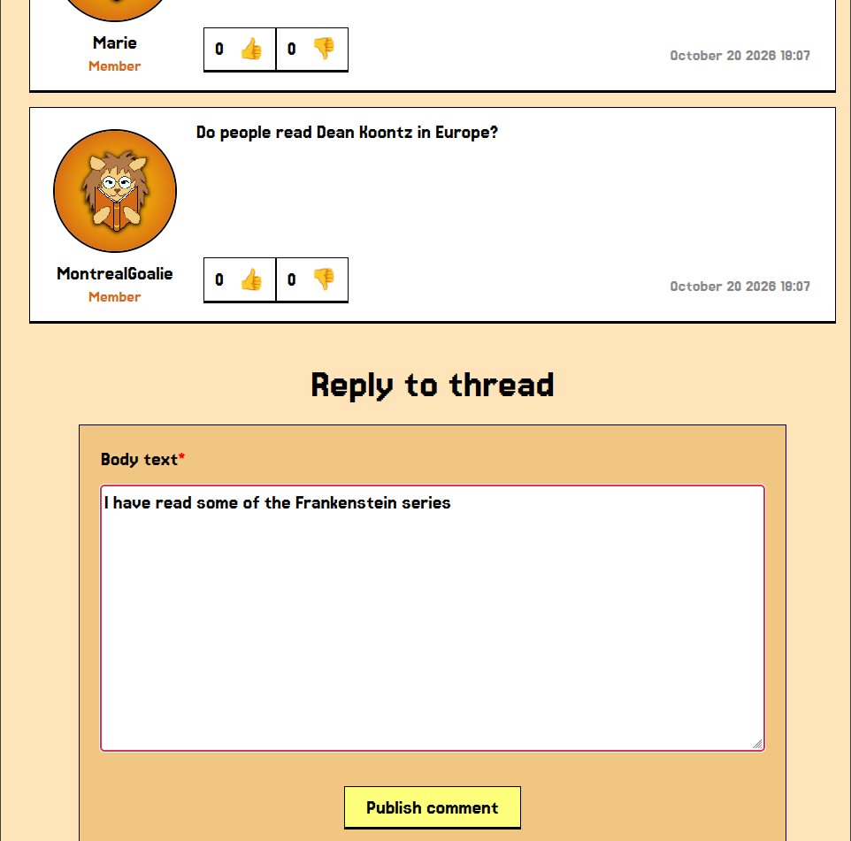

# Literary Lions
### A modern web forum with an old school look

Built using Go and SQLite  
with simple frontend, mostly HTML & CSS, minimal JavaScript  
  
  
  

# Features

- Discussion threads, organised into categories
- Viewing of threads, comments, and likes/dislikes without logging in
- Account creation, allowing users to create threads and comments, like/dislike threads and comments, and delete their own comments
- User profile pages that display a user's created threads and comments, and the threads they have liked/disliked
- Search functionality for threads and comments, allowing searching of partial words as small as three characters

# Usage / Quickstart
## With Docker
- Install [Docker](https://www.docker.com/)
- Navigate to the root directory of the project.
- Run `docker compose up --build` to build the image. 
- On subsequent runs, Docker will use the cached image, and `docker compose up` can be used.
- To stop the container, run `docker compose down`.

## Without Docker
- Navigate to the root directory of the project.
- To reset the database with seed data, use `make reset`. 
- To run the program without resetting the database, use `make run`. 

##
Once the server is running, open your browser and navigate to http://localhost:8080.

# Documentation
- [Documentation](/docs)
- [Forum Architecture](/docs/architecture.md)
- [Search Feature](/docs/search.md)

# Authors

- Ellin     ([Github](https://github.com/Ellin))
- Shane     ([Github](https://github.com/ShaneJ-77))
- Ville     ([Github](https://github.com/Wilimon))
- Joonatan  ([Github](https://github.com/tossudev))

