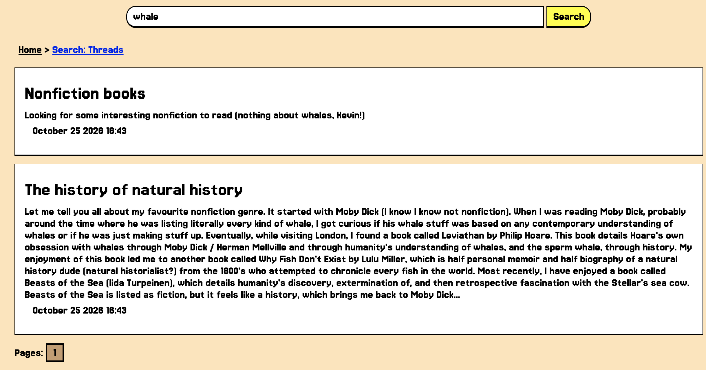

# Search (example feature)



## Overview
The search features allows the user to search the database for text matches in either threads or comments. It searchs for character strings as small as three characters. Returned results are paginated, with 5 items listed per page. Error handling has been implemented to tell the user when no results are found, or to return 404 or 500 pages appropriately.

Because the threads and comments tables are separate in the database, the search for threads and the search for comments cannot be combined. Thus, they are presented separately on the search results page.

---

## Full Text Search (FTS)
The search feature implements <b>Full Text Search</b> with the SQLite extension FTS5, which utilises virtual tables that map words to the places in the database where they can be found. This increases efficiency, versus searching every row in the relevant database tables for every search.

The migrations include triggers that update the FTS virtual tables whenever database tables are updated.

Our FTS is configured with the <b>trigram tokenizer</b>, which further breaks down words into overlapping three character sequences. This allows for searching of partial words.
```
trigram tokenizer:
"hello" becomes "hel", "ell", "ello"
```

## Pagination
Pagination is implemented anywhere in the project where multiple items are displayed.

Page numbers can be found at the bottom of the search results section for threads and the bottom of the search results section for comments. If more than one page of results exists, buttons for Next page, an arrow for the last page, and page numbers for up to five surrounding pages appear.


Default page size is set to 5, but it can be modified to anything between 1 and 100 with the "size" URL argument. Validation is done to ensure that page number and page size arguments are valid. A check is also performed to make sure that the requested page number is not larger than the number of pages of search results.

## Error Handling
The forum utilises a WriteErrorPage function in the render package that receives the error and any relevant data, parses the error and acts appropriately. 

This function is implemented in the search package as follows.

```
	//if err is 'no search results', send error to frontend and render search page
	//otherwise,  send to WriterErrorPage for parsing
	if err != nil {
		if errors.Is(err, errs.ErrSearchNoResults) {
			msg := "No results found. Please try a different search term."
			h.renderer.RenderPage(w, "search.html", SearchResultPage{Username: username, ResponseMsg: msg})
			return
		} else {
			h.renderer.WriteErrorPage(w, err, render.ErrorPage{Username: username})
			return
		}
	}
```

The search handler returns a "No results found. Please try a different search term." message when no search results are found. Otherwise, it sends the error to WriteErrorPage.

The search handler may return ErrInvalidUserInput, ErrNotFound, or StatusInternalServerError. In each case, WriteErrorPage writes the appropriate status code to the header and renders the appropriate page with the given data.

```
// WriteErrorPage renders a generic error page based on the error along with writing the http status code
func (r *Renderer) WriteErrorPage(w http.ResponseWriter, err error, pageData ErrorPage) {
	switch {
	case errors.Is(err, errs.ErrInvalidUserInput):
		w.WriteHeader(http.StatusBadRequest)
		r.RenderPage(w, "error-400.html", pageData)
	case errors.Is(err, errs.ErrUnauthorized):
		w.WriteHeader(http.StatusUnauthorized)
		r.RenderPage(w, "error-401.html", pageData)
	case errors.Is(err, errs.ErrNotFound):
		w.WriteHeader(http.StatusNotFound)
		r.RenderPage(w, "error-404.html", pageData)
	default:
		w.WriteHeader(http.StatusInternalServerError)
		r.RenderPage(w, "error-500.html", pageData)
		slog.Error("internal server error", "err", err)
	}
}
```
